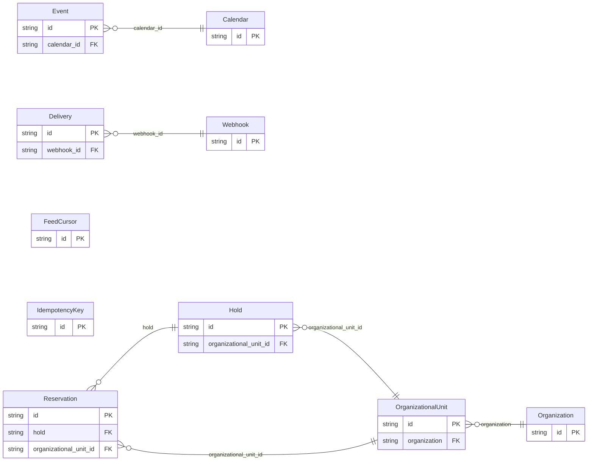

<!-- Code generated by protoc-gen-store. DO NOT EDIT. -->

# `acme` — GORM models

Go structs with GORM struct tags — one package per schema.

Generated from Protobuf by protoc-gen-store. Source of truth is the `.proto` files — regenerate rather than editing.

| Models | Enums |
| ---: | ---: |
| 10 | 3 |

## Entity relationships

## Output

- `<schema>/models.go` — one Go package per schema, one struct per table.
- `migrate.go` — a factory `Registry` (with a preloaded `Default`) that migrates every model in one call; emitted when the `go_module` opt is set. Call `Default.EnsureSchemas(db)` before `Default.Migrate(db)` so the schema-qualified tables have their Postgres schemas.
- Nullable columns are pointer types; proto enums become string-typed Go enums.
- Attach in main: `Default.EnsureSchemas(db)` then `Default.Migrate(db)`, or wire the structs into a `*gorm.DB` and run AutoMigrate yourself.
- `<schema>/<model>_store.go` — a typed CRUD store per resource (Create, GetByID, List, Count, Update, DeleteByID, plus GetBy/ListBy finders for unique and foreign-key columns); emitted when the `stores` opt is set (which also requires `go_module`). Requires `gorm.io/gorm`.
- `gormx/gormx.go` — the shared runtime every store imports: `ListOptions`, the generic `Store[M]` interface every store satisfies, a `GenericStore[M]` engine that runs CRUD for any model with no per-entity code, and `EnsureSchemas`. Lets one generic engine drive every entity.

## Schema `booking`

### `Hold` → `holds`

A hold: resources taken for a while, until confirmed or released.

| Column | Type | Null |
| --- | --- | --- |
| `id` | `CHAR(26)` | not null |
| `name` | `VARCHAR(255)` | not null |
| `quantity` | `INTEGER` | not null |
| `state` | `State` | nullable |
| `create_time` | `TIMESTAMPTZ` | not null |
| `update_time` | `TIMESTAMPTZ` | not null |
| `etag` | `VARCHAR(255)` | nullable |
| `organizational_unit_id` | `CHAR(26)` | not null |

### `Reservation` → `reservations`

A reservation: a confirmed hold.

| Column | Type | Null |
| --- | --- | --- |
| `id` | `CHAR(26)` | not null |
| `name` | `VARCHAR(255)` | not null |
| `hold` | `VARCHAR(255)` | nullable |
| `customer` | `VARCHAR(255)` | nullable |
| `create_time` | `TIMESTAMPTZ` | not null |
| `update_time` | `TIMESTAMPTZ` | not null |
| `etag` | `VARCHAR(255)` | nullable |
| `delete_time` | `TIMESTAMPTZ` | nullable |
| `purge_time` | `TIMESTAMPTZ` | nullable |
| `organizational_unit_id` | `CHAR(26)` | not null |

### Enums

- `State`: ACTIVE, CONVERTED, RELEASED

## Schema `calendar`

### `Calendar` → `calendars`

A calendar.

| Column | Type | Null |
| --- | --- | --- |
| `id` | `CHAR(26)` | not null |
| `name` | `VARCHAR(255)` | not null |
| `display_name` | `VARCHAR(255)` | not null |
| `time_zone` | `VARCHAR(255)` | nullable |
| `create_time` | `TIMESTAMPTZ` | not null |
| `update_time` | `TIMESTAMPTZ` | not null |
| `etag` | `VARCHAR(255)` | nullable |
| `delete_time` | `TIMESTAMPTZ` | nullable |
| `purge_time` | `TIMESTAMPTZ` | nullable |

### `Event` → `events`

An event on a calendar.

| Column | Type | Null |
| --- | --- | --- |
| `id` | `CHAR(26)` | not null |
| `name` | `VARCHAR(255)` | not null |
| `summary` | `VARCHAR(255)` | not null |
| `start_time` | `TIMESTAMPTZ` | not null |
| `end_time` | `TIMESTAMPTZ` | nullable |
| `create_time` | `TIMESTAMPTZ` | not null |
| `update_time` | `TIMESTAMPTZ` | not null |
| `etag` | `VARCHAR(255)` | nullable |
| `delete_time` | `TIMESTAMPTZ` | nullable |
| `purge_time` | `TIMESTAMPTZ` | nullable |
| `calendar_id` | `CHAR(26)` | not null |

## Schema `directory`

### `Organization` → `organizations`

An organization: the tenant everything else belongs to.

| Column | Type | Null |
| --- | --- | --- |
| `id` | `CHAR(26)` | not null |
| `name` | `VARCHAR(255)` | not null |
| `display_name` | `VARCHAR(255)` | not null |
| `registration` | `VARCHAR(255)` | nullable |
| `create_time` | `TIMESTAMPTZ` | not null |
| `update_time` | `TIMESTAMPTZ` | not null |
| `etag` | `VARCHAR(255)` | nullable |
| `delete_time` | `TIMESTAMPTZ` | nullable |
| `purge_time` | `TIMESTAMPTZ` | nullable |

### `OrganizationalUnit` → `organizational_units`

An organizational unit: a site resources are booked at.

| Column | Type | Null |
| --- | --- | --- |
| `id` | `CHAR(26)` | not null |
| `name` | `VARCHAR(255)` | not null |
| `display_name` | `VARCHAR(255)` | not null |
| `organization` | `CHAR(26)` | not null |
| `create_time` | `TIMESTAMPTZ` | not null |
| `update_time` | `TIMESTAMPTZ` | not null |
| `etag` | `VARCHAR(255)` | nullable |
| `delete_time` | `TIMESTAMPTZ` | nullable |
| `purge_time` | `TIMESTAMPTZ` | nullable |

## Schema `requestkeys`

### `IdempotencyKey` → `idempotency_keys`

An idempotency key: one (method, request_id) and its first response.

| Column | Type | Null |
| --- | --- | --- |
| `id` | `CHAR(26)` | not null |
| `name` | `VARCHAR(255)` | not null |
| `method` | `VARCHAR(255)` | not null |
| `request_id` | `VARCHAR(255)` | not null |
| `state` | `State` | nullable |
| `response` | `VARCHAR(255)` | nullable |
| `create_time` | `TIMESTAMPTZ` | not null |
| `update_time` | `TIMESTAMPTZ` | not null |

### Enums

- `State`: IN_FLIGHT, DONE

## Schema `webhook`

### `Webhook` → `webhooks`

A webhook: an endpoint subscribed to changes.

| Column | Type | Null |
| --- | --- | --- |
| `id` | `CHAR(26)` | not null |
| `name` | `VARCHAR(255)` | not null |
| `uri` | `VARCHAR(255)` | not null |
| `event_types` | `VARCHAR(255)[]` | nullable |
| `organizational_unit` | `VARCHAR(255)` | nullable |
| `paused` | `BOOLEAN` | nullable |
| `secret` | `VARCHAR(255)` | nullable |
| `create_time` | `TIMESTAMPTZ` | not null |
| `update_time` | `TIMESTAMPTZ` | not null |
| `etag` | `VARCHAR(255)` | nullable |

### `Delivery` → `deliveries`

A delivery: one change recorded for one webhook.

| Column | Type | Null |
| --- | --- | --- |
| `id` | `CHAR(26)` | not null |
| `name` | `VARCHAR(255)` | not null |
| `event_id` | `VARCHAR(255)` | nullable |
| `event_type` | `VARCHAR(255)` | nullable |
| `subject` | `VARCHAR(255)` | nullable |
| `payload` | `VARCHAR(255)` | nullable |
| `state` | `State` | nullable |
| `attempt_count` | `INTEGER` | nullable |
| `next_attempt_time` | `TIMESTAMPTZ` | nullable |
| `response_code` | `INTEGER` | nullable |
| `error_message` | `VARCHAR(255)` | nullable |
| `deliver_time` | `TIMESTAMPTZ` | nullable |
| `create_time` | `TIMESTAMPTZ` | not null |
| `update_time` | `TIMESTAMPTZ` | not null |
| `etag` | `VARCHAR(255)` | nullable |
| `webhook_id` | `CHAR(26)` | not null |

### `FeedCursor` → `feed_cursors`

A feed cursor: how far a change feed has been read.

| Column | Type | Null |
| --- | --- | --- |
| `id` | `CHAR(26)` | not null |
| `name` | `VARCHAR(255)` | not null |
| `position_time` | `TIMESTAMPTZ` | not null |
| `update_time` | `TIMESTAMPTZ` | not null |
| `etag` | `VARCHAR(255)` | nullable |

### Enums

- `State`: PENDING, SUCCEEDED, FAILED
